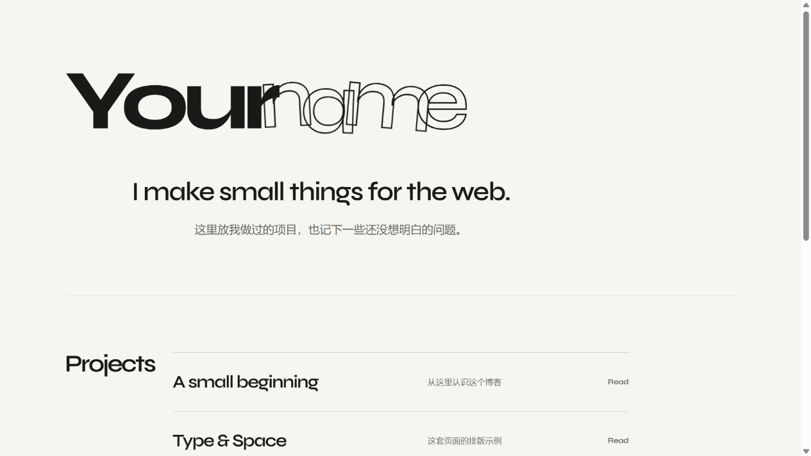

# Blog Studio

一个带本地编辑器的静态博客模板。大字、描边姓名、米白底、项目与文章索引，以及完整的长文页面。

克隆下来，改成自己的首页，开始写。上线后只有 HTML、CSS、JavaScript 和静态资源，读者无需连接 Studio。



## 开始

需要 **Node.js 22 或更新版本**。编辑和预览不需要 Git 登录；发布时需要 Git、你自己的仓库和凭据。

1. 在 GitHub 上使用 **Use this template** 创建自己的仓库；也可以下载源码或克隆到本地。
2. 在项目目录运行：

   ```sh
   npm ci
   npm run studio
   ```

3. 打开 [本地 Studio](http://127.0.0.1:4174/studio/)，进入「首页与站点设置」，填写名称、介绍、项目和链接。
4. 保存到本地，再去文章编辑器修改示例或新建文章。

首页姓名分为实心和描边两部分，可以填写中文或英文。显示名称用于署名和无障碍文本。站点地址可先留空；正式部署时填写完整地址，例如 `https://username.github.io/` 或 `https://username.github.io/my-blog/`。

端口被占用时，设置 `BLOG_STUDIO_PORT`。PowerShell 示例：

```powershell
$env:BLOG_STUDIO_PORT = '4176'
npm run studio
```

## 写文章

Studio 提供标题、分行大标题、栏目、日期、摘要和阅读时长表单。正文可以直接在预览中编辑，也可以切到 HTML 模式；工具栏支持段落、标题、列表、链接、代码块、提示块和图片。`Ctrl/Cmd + S` 保存到本地。图片写入 `assets/posts/<slug>/`。

保存后会创建 `posts/<slug>.html`，并更新首页 Writing 列表。Slug 是文章地址的一部分，保存后不能在界面中修改。需要删除示例时，删除对应 `posts/*.html` 文件，然后重启 Studio 或运行构建；示例项目链接也要在首页设置中移除。

**保存不是私密草稿状态。所有已保存文章都会进入下一次构建和站点发布。** 尚未准备公开的文字请保存在仓库之外。正文支持作者自行编写的 HTML；Studio 是你自己的本地工具，不是供陌生人提交 HTML 的平台。为了保护编辑环境，可编辑预览不会执行文章脚本；交互脚本可以在单独打开的文章页检查。

## 部署到 GitHub Pages

1. 把这个项目放进你自己的 GitHub 仓库，默认分支为 `main`。如果通过模板创建，克隆后已配置自己的 `origin`；直接克隆本项目的使用者需要把 `origin` 改成自己的仓库。
2. 仓库 **Settings → Pages → Build and deployment → Source** 选择 **GitHub Actions**。
3. 在首页设置里填好正式站点地址并保存。首次推送整个项目；后续日常更新可以点击 Studio 的「发布站点」。
4. 在 GitHub 的 Actions 页面查看 **Build and deploy blog**。推送成功表示 Git 已同步，部署是否成功以 Actions 为准。

发布窗口会列出目标分支。Studio 会提交站点配置、首页、全部已保存文章和静态资源，并推送 `origin` 上的同名分支；其他已存在的本地提交也会一并推送。编辑器源码、文档等未提交修改不会进入这个内容提交，修改主题或程序后请自行用 Git 提交。内置部署工作流只响应 `main`，其他分支可以用于预览或自行配置工作流。

推送失败时本地内容仍然存在；检查 Git 身份、远程地址、网络和分支状态后重试。Studio 不会强制推送，不保存 GitHub Token。

工作流按 [GitHub Pages 的官方自定义工作流说明](https://docs.github.com/en/pages/getting-started-with-github-pages/using-custom-workflows-with-github-pages) 配置，仅上传 `dist/`。

## 部署到其他静态托管

```sh
npm run build
```

把 `dist/` 的内容交给任意支持静态文件的托管服务。输出包含首页、文章、样式和资源，不包含 Studio、Node 依赖、配置源文件或 Git 历史。资源链接使用相对路径，支持部署在子目录。`url` 留空时不生成 canonical 地址，不会误指向模板作者的网站。

## 目录与定制

| 文件 / 目录 | 用途 |
| --- | --- |
| `site.config.json` | 首页、身份、链接、站点地址；由设置页编辑，也可以手工修改 |
| `posts/` | 文章 HTML，正文和文章元数据的来源 |
| `theme/home.html` | 首页结构模板 |
| `theme/article.html` | 新文章模板 |
| `theme/styles.css` / `theme/script.js` | 配色、排版和首页动效 |
| `assets/` | 字体及公开资源；上传图片进入 `assets/posts/` |
| `index.html` / 根目录 CSS、JS | Studio 生成的本地预览，不要直接修改这些生成文件 |
| `studio/` | 本地编辑器、HTTP API、Git 适配器与测试 |
| `dist/` | 构建产物，默认不进入 Git |

修改配置、模板或主题后重启 Studio，可以同步本地预览；`npm run build` 总是读取最新源文件。已有文章的正文与自定义脚本会保留，站点名称、导航及分享信息由配置统一更新。`theme/article.html` 的结构修改只影响新文章；要批量迁移旧文章结构，需要自行处理。

Studio 使用中文界面，公共页面保留 `Projects` / `Writing` / `Read` 的英文栏目风格。`language` 用于声明内容语言，不是界面翻译开关。当前没有文章删除按钮、私密草稿状态、云端多人编辑或 Markdown 导入。

## 开发

```sh
npm ci
npm test
npm run build
```

测试覆盖文章往返编辑、配置与地址校验、静态导出和本地 HTTP/Git 流程。Git 测试只向临时目录里的 bare 仓库推送。贡献说明见 [CONTRIBUTING.md](CONTRIBUTING.md)，架构见 [SPEC.md](SPEC.md)。

## License

代码和示例内容使用 [MIT](LICENSE)。字体使用 [SIL OFL 1.1](assets/fonts/SYNE-OFL.txt)。其他说明见 [THIRD_PARTY_NOTICES.md](THIRD_PARTY_NOTICES.md)。

---

**English quick start:** Blog Studio is an editorial static blog template with a local visual/HTML editor. Install Node.js 22+, run `npm ci && npm run studio`, customize your homepage in the settings screen, and write your own posts. Run `npm run build` and deploy `dist/`, or enable GitHub Actions as the Pages source. The Studio interface is in Chinese. All saved posts are included in the next build; there is no private-draft state. MIT licensed, with the bundled Syne font under SIL OFL.
