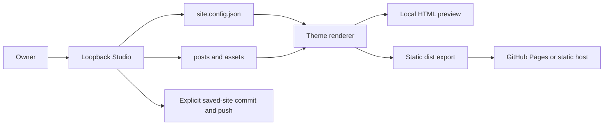

# Blog Studio

## Purpose and scope

A reusable personal blog with the editorial home and article layouts of the original site, plus a local authoring studio. Owners configure identity, introduction, projects, links and public URL; write HTML articles through a visual editor; export a static site; optionally publish saved site content through their own Git repository.

No hosted editor, database, account system or prose generation. The original blog is a separate repository and is not modified by this extraction.

## Current Architecture

## Target Architecture

## Contracts

- `site.config.json` is the source for name/stem/tail, language, site title, description, public URL, introduction, project links and social links. URLs accept safe web/mail or portable relative links; canonical URLs require an optional absolute HTTP(S) base including any repository subpath.
- `posts/*.html` own article text and metadata. Site chrome is managed by the theme; custom article content and scripts survive metadata updates. `index.html` is generated from configuration and all saved posts.
- `theme/` holds home/article templates and static CSS/JS. `assets/` holds the licensed font and owner assets. No personal content from the source blog is distributed.
- `studio/` contains the local UI, HTTP server, adapters and tests. `scripts/build.mjs` exports only rendered public HTML, CSS, JS, assets and `.nojekyll` into `dist/`.
- Save means writing public-source files locally. All saved articles are included in export/publication; there is no private-draft state. Git publication includes config, homepage, posts and assets; unrelated uncommitted code remains outside that commit. Existing branch commits are also pushed, clearly disclosed in the UI.
- Editor binds only to loopback and rejects cross-origin writes. Git credentials remain in the owner's Git installation. Preview disables article scripts inside the editable frame.
- Root and module plans must reflect tested behavior. Public repository creation is a separate final publishing step.
