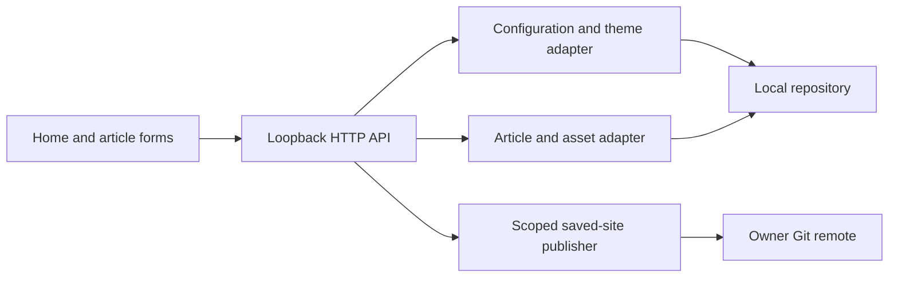

# Local Studio

## Connected Nuxt workspace (0.2)

`studio.config.local.json` or `BLOG_STUDIO_SITE_ROOT` selects an external Nuxt blog.
The editor's application files remain in this repository; content and Git operations
target the explicitly configured blog checkout. No changes are made to its articles
at startup or while saving local drafts. Without workspace configuration the original
standalone HTML/site-settings routes and template build remain available.

`lib/workspace.mjs` owns Markdown/frontmatter loading, local versioned JSON drafts,
read-only sanitized preview, staged image assets and per-article dual-style publication.
The local HTTP mutation queue and Origin/Host checks apply to both adapters. Local
drafts are excluded from Git and from static-serving allowlists. Preview executes no
scripts, including analytics. A published draft is archived only after Git succeeds.

GET `/api/workspace` exposes the selected target and schema categories; existing
posts/template/status endpoints use the workspace adapter. POST `/api/preview`
renders the current manuscript. `/api/save` writes only a local JSON draft, while
`/api/publish` requires an explicit request and synchronizes only the current article,
its assets, the classic writing index and its legacy redirect before scoped Git push.

Theme previews reuse published Editorial SSR markup/CSS or the local classic
article renderer. Only existing public template URLs are fetched; manuscript data
is inserted locally. Public templates are cached in the private workspace folder.
Scripts, trackers, embedded frames, and event attributes are removed. Full-width
preview uses a sandboxed modal iframe, so desktop layout can be inspected separately
from the narrow split pane. If the actual theme cannot be loaded, the API returns an
explicit body-only fallback notice. Read-only preview requests bypass the mutation
queue, and concurrent template fetches are coalesced to avoid delaying autosave.

No AI providers, prompts, generated prose, cloud draft storage or credential forms
are part of this mode. Autosave and saved revisions are local to this machine.

## Scope

Loopback-only authoring: article library, metadata, visual/HTML editing, images, preview, homepage settings, and an explicit Git publish dialog. No credentials stored by Studio. Homepage uses a separate form so article drafts do not get overwritten during customization.

## Current Architecture

## Target Architecture

## Contracts and boundaries

GET `/api/site`, `/api/posts`, `/api/template`, `/api/status`, `/api/posts/:slug`. POST `/api/site` takes `{site}`; `/api/save` takes `{article}`; `/api/assets` takes `{slug,fileName,dataUrl}`; `/api/publish` takes optional `{article,commitMessage}` and publishes all saved public content. JSON envelopes use `ok`, with error `code`, `error`, optional `details` and retry `context`.

Article fields: slug, isNew, title, headlineLines, kicker, deck, description, date, readMinutes, contentHtml. Loaded articles also provide sourceHtml for real-page preview. State changes require JSON and matching Origin when supplied. Static files use allowlisted roots; symlinks escaping them are rejected. Author HTML is trusted, but scripts and event handlers are stripped from the editable preview to protect the local editor. Editor runtime never ships in dist.
