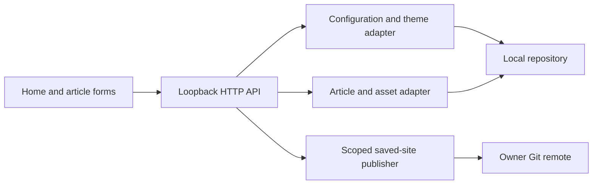

# Local Studio

## Scope

Loopback-only authoring: article library, metadata, visual/HTML editing, images, preview, homepage settings, and an explicit Git publish dialog. No credentials stored by Studio. Homepage uses a separate form so article drafts do not get overwritten during customization.

## Current Architecture

## Target Architecture

## Contracts and boundaries

GET `/api/site`, `/api/posts`, `/api/template`, `/api/status`, `/api/posts/:slug`. POST `/api/site` takes `{site}`; `/api/save` takes `{article}`; `/api/assets` takes `{slug,fileName,dataUrl}`; `/api/publish` takes optional `{article,commitMessage}` and publishes all saved public content. JSON envelopes use `ok`, with error `code`, `error`, optional `details` and retry `context`.

Article fields: slug, isNew, title, headlineLines, kicker, deck, description, date, readMinutes, contentHtml. Loaded articles also provide sourceHtml for real-page preview. State changes require JSON and matching Origin when supplied. Static files use allowlisted roots; symlinks escaping them are rejected. Author HTML is trusted, but scripts and event handlers are stripped from the editable preview to protect the local editor. Editor runtime never ships in dist.
