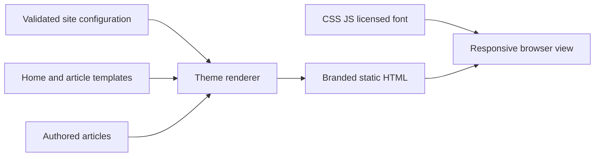

# Editorial theme

## Scope and contracts

Off-white background, self-hosted Syne display type, outlined name tail, quiet motion, line-based project/writing indexes, and large article headlines with a narrow reading column. Name, intro, projects and links are data, not hardcoded author identity. `home.html` is a structural template; `article.html` supplies new article markup. CSS and JS are portable static assets. Article body HTML stays authored content.

## Current Architecture

## Target Architecture

All theme resource URLs are relative so a GitHub Pages repository subpath works. When public URL is blank, canonical metadata is omitted. Escaping applies to config strings; authored HTML remains trusted. Home/article metadata and visible identity derive from the same config. Reduced motion and no-JS access are preserved.
